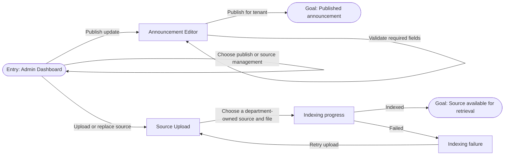

# HeronHub First Look

**Status:** Structure review
**Audience:** Department Admin
**Platform priority:** Desktop and projector, with a phone fallback

## Design Spec

### Primary Flow



### Core Screens

1. **Admin Dashboard:** Opens with direct publishing and source-management actions, followed by source health, active announcements, a flat announcement-history list, and active sources.
2. **Announcement Editor:** Creates a tenant-scoped announcement with title, message, and active dates. Publishing returns the admin to a success state.
3. **Source Upload:** Accepts a new or replacement organizer file for the Department Admin's tenant, then makes percentage-based indexing progress and an actionable failure state visible.

### Desktop Wireframes

#### 1. Admin Dashboard

```text
+--------------------------------------------------------------------------------------------------+
| HeronHub                         CCIS Admin                                        Profile      |
+----------------+-------------------------------------------------------------------------+-------+
| Navigation     | ADMIN DASHBOARD                                                       |       |
|                | Good morning, CCIS. Here is what needs attention.                      |       |
| [Dashboard]    |                                                                         |       |
| Announcements  | +---------------------+ +----------------------+                         |       |
| Sources        | | 1 source needs     | | 2 active notices    |                         |       |
|                | | review              | | Manage notices       |                         |       |
|                | +---------------------+ +----------------------+                         |       |
|                |                                                                         |       |
|                | ACTION QUEUE                                                            |       |
|                | +----------------------------------------------------------------------+ |       |
|                | | Source02.md replacement pending                    [Review source] | |       |
|                | +----------------------------------------------------------------------+ |       |
|                |                                                                         |       |
|                | [ Publish announcement ]                    [ Upload source ]          |       |
+----------------+-------------------------------------------------------------------------+-------+
```

Components: persistent navigation, tenant switcher, operational metrics, source-health status, primary actions.

#### 2. Announcement Editor

```text
+--------------------------------------------------------------------------------------------------+
| HeronHub / Announcements                                                     Draft status       |
+--------------------------------------------------------------------------------------------------+
| Create announcement                                                                             |
| A clear update for the audience that needs it.                                                  |
|                                                                                                  |
| Title *                                                                                          |
| [ Enrollment advising opens                                               ]                      |
|                                                                                                  |
| Message *                                                                                        |
| [ Bring your latest grade report before finalizing subjects.               ]                      |
| [                                                                         ]                      |
|                                                                                                  |
| Starts *                                    Ends *                                               |
| [ 2026-10-13                            ] [ 2026-10-20                            ]               |
|                                                                                                  |
| [ Cancel ]                                               [ Publish announcement ]                  |
+--------------------------------------------------------------------------------------------------+
```

Components: page header, labelled fields, date fields, inline validation, tenant-aware consent, and publish confirmation.

#### 3. Source Upload and Indexing

```text
+--------------------------------------------------------------------------------------------------+
| HeronHub / Sources                                                          CCIS                |
+--------------------------------------------------------------------------------------------------+
| Replace a source                                                                               |
| Upload a new version. The existing active version remains available until indexing succeeds.   |
|                                                                                                  |
| Source document                       Replacement status                                         |
| [ Source02.md                       ] [ Current version active                               ] |
|                                                                                                  |
| +----------------------------------------------------------------------------------------------+ |
| | Drop a .md, .pdf, or .docx file here                                      [Choose file]     | |
| +----------------------------------------------------------------------------------------------+ |
|                                                                                                  |
| Indexing replacement                                                        66% complete       |
| [============================================                              ]                   |
|                                                                                                  |
| Failure example                                                                                 |
| The file could not be read. The current version is still live. [Retry upload]                   |
+--------------------------------------------------------------------------------------------------+
```

Components: department-owned source selector, upload target, percentage progress status, non-destructive failure message, retry action.

### Phone Fallback

```text
+--------------------------------------+
| H  HeronHub                    Menu  |
+--------------------------------------+
| CCIS Admin                             |
| Good morning.                          |
|                                        |
| [1 source needs review]                |
| [2 active notices]                     |
|                                        |
| ACTION QUEUE                           |
| Source replacement pending             |
| [Review source]                        |
|                                        |
| [Publish announcement]                 |
| [Upload source]                        |
+--------------------------------------+
```

On phones, the navigation becomes a menu, summary metrics stack, and forms become one field per row with the publish action fixed at the end of the form.

### Round 1 Decisions (2026-10-13)

- The first look targets Department Admins, rather than students.
- The entry screen is the admin dashboard.
- The demo goal is an admin dashboard and upload workflow.
- Desktop and projector presentation take priority.
- The board contains three core screens: Admin Dashboard, Announcement Editor, and Source Upload.
- The Admin Dashboard leads with direct publishing and source-management actions.
- Source management shows replacement indexing progress.
- The board includes an indexing failure state with a retry action.

### Round 2 Decisions (2026-10-13)

- The three-screen structure is approved.
- Every announcement requires a start date and end date.
- The announcement editor inherits its audience from the Department Admin tenant.
- University-wide sources are managed only by a System Admin and are not visible in the Department Admin console.
- Source replacement inherits the Department Admin tenant and does not expose a tenant selector.
- Operations Console is the approved visual direction for the Department Admin dashboard.
