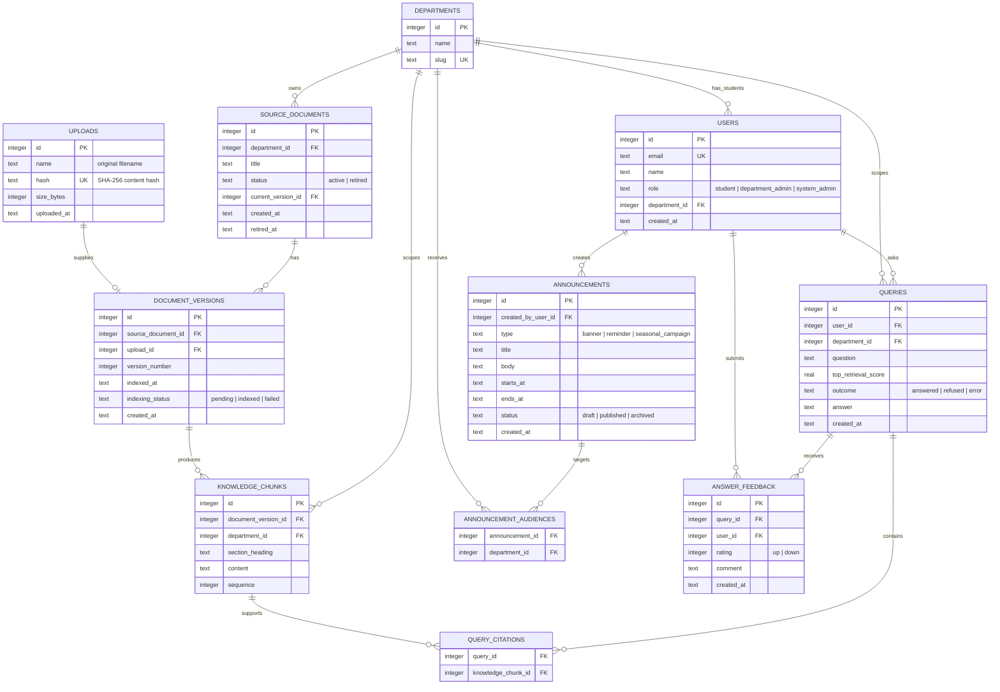

# HeronHub Entity Relationship Diagram

This is the starting data model for the admin studio, student hub, and strictly grounded chatbot. Timestamps are UTC ISO-8601 values. IDs are SQLite integer primary keys unless noted otherwise.

## Model Rules

- `uploads` records each physical file once. A SHA-256 `hash` is unique to prevent duplicate ingestion; `name` is the original filename and is not unique.
- `source_documents` is the durable logical document. Replacing a file creates a new `document_versions` row and updates `current_version_id`; previous versions remain auditable.
- Retiring a document changes `source_documents.status` to `retired`. Its chunks must be excluded from retrieval without deleting the history.
- Every user belongs to one department. Student views, document retrieval, announcement audiences, and query analytics are scoped to that department.
- A banner, reminder, or seasonal campaign is one `announcements` record. It can target several departments through `announcement_audiences`.
- A refused query is a `queries` record with `outcome = 'refused'`. The admin gap list is a filtered view of those rows, grouped by department and question.
- Every visible chatbot citation is stored in `query_citations`, linking the answer to the exact chunk used. This makes source-grounding auditable.
- `answer_feedback` supports the P1 thumbs-up/down control and optional comment. CSV export is generated from this table and its query metadata rather than persisted as a separate entity.

## Initial SQLite Migration Order

1. `0001_init.sql`: `departments`, `users`, and `uploads`.
2. `0002_knowledge_base.sql`: document, version, and chunk tables.
3. `0003_announcements.sql`: announcement and audience tables.
4. `0004_query_analytics.sql`: query, citation, and feedback tables.

`current_version_id` is added after `document_versions` exists, or populated within the same migration with SQLite foreign keys enabled.
