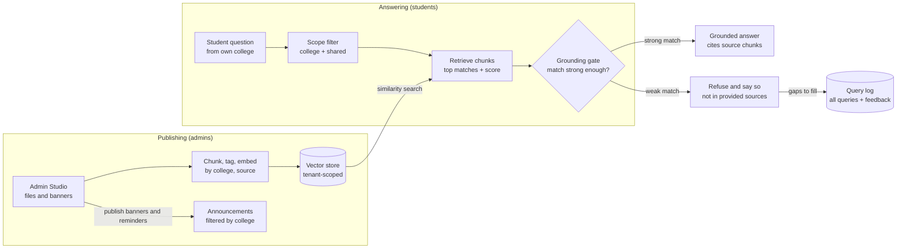

# HeronHub: Product Requirements Document

HeronHub ("HeronHub" is a working name) is a centralized, college-aware campus hub whose AI answers only from official documents and says so when it cannot.

## 1. Product Vision & Success Metrics

**Vision:** every UMak student, faculty member and admin gets a verified answer or the right reminder in under a minute, from one place, filtered to their own college.

| Outcome | Student | Admin | Target (hackathon-stage, to validate) |
| --- | --- | --- | --- |
| Answer accuracy | Trusts what the bot says | Does not field repeat questions | 100% of answers cite a source chunk; 0 uncited answers |
| Refusal quality | Told when the sources do not cover it | Sees which gaps to fill | Out-of-scope questions refused in 95%+ of test cases |
| Deadline awareness | Sees reminders for own college | Reaches the right audience | Reminder visible within 1 click of opening the hub |
| Admin speed | n/a | Publishes a monthly update | Under 5 minutes from login to live banner |
| Knowledge freshness | Gets current rules | Uploads a revised file | New file answerable within 2 minutes of upload |

Targets are design goals for the demo and pilot, not measured results.

## 2. User Personas

| Persona | Who | Main job to be done | Pain today | Key needs |
| --- | --- | --- | --- | --- |
| Student | A CCIS freshman or shifter, an incoming scholar | Find a requirement, office or deadline without walking the building | Info split across documents, offices and floors | Cited answers, college-filtered feed, reminders |
| Department Admin | A dean's office or center staff member (e.g. CCIS, CAS, OUR) | Publish updates and keep the AI's sources current | Repeats the same answers; cannot see what students ask | Banner editor, file upload, query and feedback insights |
| System Admin | CIT / ITSO staff running the platform | Add colleges, set roles, keep the system safe | No single place to manage access and sources | Tenant setup, role control, audit log, ingestion health |

## 3. Knowledge Base Scope

The four organizer files cover scholarships, college admission requirements, campus offices and building maps. Tag every chunk with its source file and a college or office so retrieval can be scoped.

| File | Contents | Natural scope tag |
| --- | --- | --- |
| Source01 | Scholarships: basic requirements, OLEA application steps, 25+ grant types, FAQ | Scholarships / CAS |
| Source02 | CCIS program requirements (BSCS, BSIT, BSIS, two diplomas); list of 16 colleges | CCIS / admissions |
| Source03 | Campus map: offices and rooms by building, floor and wing | Campus navigation |
| Source04 | Office profiles: heads, functions, services (OUR, CIT, HRMO, GSO, clinic, CSOA...) | Offices / services |

**Known inconsistencies the bot must handle.** These are an asset for the demo: they prove the guardrails by showing the bot flags conflicts instead of picking one silently.

- Source01 FAQ says all incoming undergraduates are automatically scholars with no application. The scholarship sections describe an application through OLEA with per-type requirements.
- The "Partial Entrance Token Fee Exemption Grant" description repeats the Full grant wording (Highest Honor, GWA 98 to 100), while its requirements say High Honor, GWA 95 to 97.
- The first "Persons with Disability R.A. 9442" entry describes military dependents (P.D. 577). The second entry matches R.A. 9442 and mentions CIE endorsement.
- The "CCAPS Special Programs (15%)" entry is titled 15% but its text says Tier 4, 25% exemption, duplicating the 25% entry.
- The "Theater Artist" entry reuses Sister City Scholar text. The "Corps of Sponsor" entry names CNSTP in the description and CCA in the requirement.
- Office names differ across files (CDPRM vs CAIG; CBFS vs CBA; IOA vs Institute of Accountancy and Finance). Source04's Center for Research Management paragraph ends mid-sentence.

**Rule:** when retrieved chunks disagree, the bot shows both with citations and says the sources conflict, then points to the owning office (for scholarships, the Center for Admission and Scholarships).

## 4. System Architecture & Data Flow

Top row: admins publish source files (chunked, tagged by college and source, embedded into a tenant-scoped vector store) and announcements. Middle row: a student's question is limited to their college's chunks plus shared ones, then retrieved with a similarity score. Bottom row: the grounding gate sends strong matches to the LLM with only those chunks as context, and weak matches to a fixed refusal. Refusals feed the admin's gap list.

**Prompt-level grounding.** The system prompt allows only the retrieved chunks as context and requires a citation (file and section) per claim. It forbids outside knowledge and requires the exact fallback "Information not in provided sources" when the chunks do not answer the question. Instructions found inside documents or questions are treated as data, never as commands.

## 5. Functional Requirements

Priority: **P0** = needed for the live demo, **P1** = build if time allows, **P2** = mention in the pitch as roadmap.

### FR1. Strict source-grounded chatbot (RAG)

| ID | Requirement | Priority |
| --- | --- | --- |
| FR1.1 | Answer only from retrieved chunks of organizer-provided files; no general-knowledge fallback. | P0 |
| FR1.2 | Every answer shows citations: file name and section heading (e.g. "Source01, Dean's Lister (Full)"). | P0 |
| FR1.3 | If top retrieval score is below threshold or chunks do not answer the question, reply exactly "Information not in provided sources" and name the office likely to know, only if the sources state it. | P0 |
| FR1.4 | When retrieved chunks conflict, show both with citations and flag the conflict (see Knowledge Base Scope). | P1 |
| FR1.5 | Block prompt injection: retrieved text and user input are wrapped as data; system rules cannot be overridden; output is checked for a citation before display. | P0 |
| FR1.6 | Answers in the language of the question (English or Filipino) while quoting sources as written. | P2 |

### FR2. Multi-tenant college and department segmentation

| ID | Requirement | Priority |
| --- | --- | --- |
| FR2.1 | Every chunk and announcement carries a tenant tag: a college or office, or "University-wide". | P0 |
| FR2.2 | A student's profile sets their college (e.g. CCIS); retrieval and the feed show that college plus University-wide content. | P0 |
| FR2.3 | Student can switch the filter to browse another college's public content. | P1 |
| FR2.4 | Department admins can publish and edit only within their own tenant. | P0 |

### FR3. Dynamic content and reminders

| ID | Requirement | Priority |
| --- | --- | --- |
| FR3.1 | Monthly banner/announcement editor: title, body, audience (college), start and end date. | P0 |
| FR3.2 | Seasonal campaign toggles with presets (Mental Health Awareness Month, midterms week, enrollment deadlines) that pin a themed card for the chosen audience. | Deferred |
| FR3.3 | Reminder cards sorted by date, with a visible "ends in N days" label. | P1 |
| FR3.4 | Optional email or push reminder before a deadline. | P2 |

### FR4. Admin analytics and feedback retrieval

| ID | Requirement | Priority |
| --- | --- | --- |
| FR4.1 | Top questions by college and period, from the query log. | Deferred |
| FR4.2 | List of refused questions ("gaps") so admins know what to upload next. | Deferred |
| FR4.3 | Thumbs up/down and a short feedback form on every answer; admins can export submissions as CSV. | P1 |
| FR4.4 | Source management: upload, replace and retire a source file; the uploaded version is immediately available when the upload completes. | P0 |

## 6. Non-Functional Requirements

| Area | Requirement | How we meet it in a hackathon build |
| --- | --- | --- |
| Latency | First answer token in about 3 seconds on the demo network | Small corpus, top-k of 4 to 6 chunks, streamed response |
| Source privacy | Staff-only documents never leak to students; no student personal data sent into prompts | Tenant and visibility tags enforced before retrieval; question text only, no profile data in prompts |
| Data protection | Query logs minimized; follows the university's data privacy policy (CAIG oversees it) | Store question, college, score and timestamp; no names |
| Deployability | One-command run, free-tier hosting, nothing that needs hours of setup | One web app plus a managed or embedded vector store |
| Reliability | Demo survives a model or network failure | Cached answers for the scripted demo questions; clear error state |
| Maintainability | Adding a college is configuration, not code | Tenant table and tag-driven filters |
| Accessibility | Readable on a phone and a projector | Responsive layout, high-contrast theme, large type |
